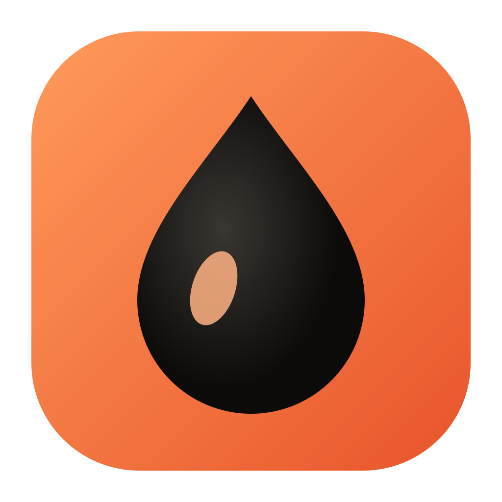
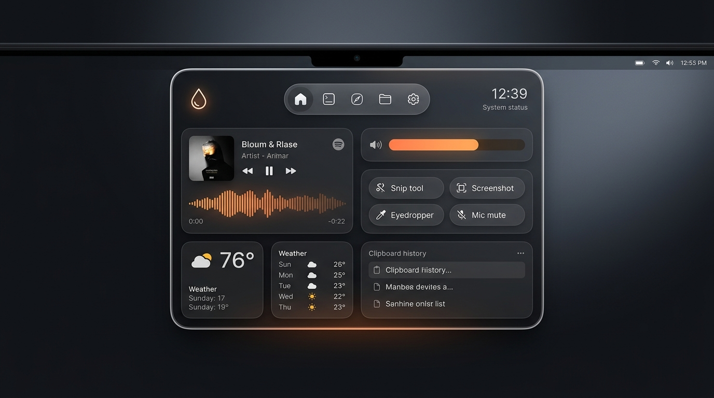
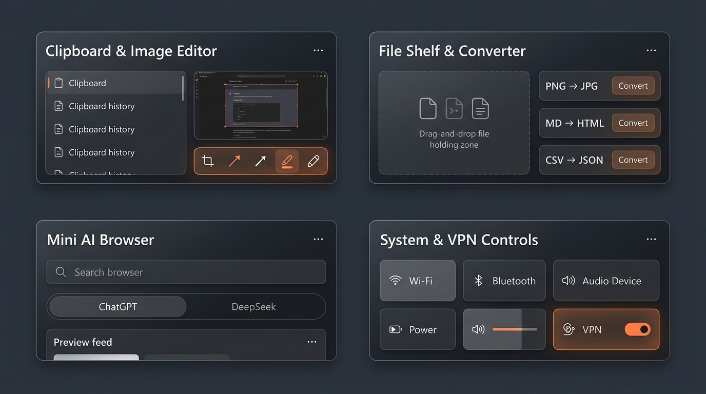

<div align="center">



# Kapla

**Интерактивный Dynamic Island оверлей для Windows 11**  
*Дымчатое жидкое стекло, управление музыкой, буфер обмена, полка файлов, мини-браузер с ИИ и системный пульт — у верхнего края экрана.*


<br />



</div>

---

## О проекте

**Kapla** — лёгкая «капля»-оверлей, которая живёт в верхней части экрана Windows и раскрывается по наведению, клику или горячей клавише. Физика формы работает на пружинном 2D-движке (`Liquid` + `Spring`) с дымчатым стеклом, живой реакцией на курсор, обложку трека и звук.

- Двойной клик по капсуле или заголовку панели сворачивает островок в компактный **мини-режим**.
- В свёрнутом состоянии капсула реагирует на смену громкости, раскладки, `Caps Lock`, микрофона, копирование текста и свежие скриншоты.
- При перетаскивании любого файла к верхнему краю экрана автоматически открывается **Полка**.

---

## Возможности и разделы

<div align="center">
  
</div>

<br />

| Раздел | Что умеет |
| :--- | :--- |
| **Главная** | Плеер текущего трека с обложкой и динамическим акцентом, погода, громкость, быстрые действия (Ножницы, Скриншот, Пипетка цвета, Микрофон) и последние элементы буфера |
| **Буфер** | История скопированного текста и изображений, поиск, закрепление, вставка в активное окно по клику и встроенный **редактор скриншотов** |
| **Полка** | Временное хранилище файлов (Drag & Drop внутрь и наружу в другие приложения) + встроенный **конвертер файлов** (изображения `PNG/JPG/WebP/ICO`, `Markdown ↔ HTML`, `CSV ↔ JSON`) |
| **Текст** | Быстрое преобразование текста (регистр, транслит, очистка пробелов, Base64/URL и др.) |
| **Заметка** | Быстрые заметки с автосохранением и встроенный таймер обратного отсчёта в капсуле |
| **Браузер** | Встроенный WebView2 мини-браузер с сохранением сессии и быстрыми пресетами (ChatGPT, DeepSeek и др.) |
| **Пульт** | Раскрывающиеся панели **Wi-Fi**, **Bluetooth**, **VPN** (запуск выбранного VPN-клиента/профиля), устройства вывода звука, питание и настройки внешнего вида |

---

## Горячие клавиши и управление

| Комбинация / жест | Действие |
| :--- | :--- |
| `Ctrl + Alt + I` | Открыть / закрыть панель Kapla |
| `Ctrl + Alt + V` | Открыть историю буфера обмена |
| `Ctrl + Alt + M` | Включить / выключить микрофон |
| `Колёсико` над капсулой | Регулировка системной громкости |
| `Двойной клик` по капсуле / шапке | Переключение мини-режима |
| `Drag & Drop` к верху экрана | Автооткрытие Полки для приёма файлов |

---

## Стек

- **Frontend:** Svelte 5, TypeScript, Vite 8, кастомный Canvas-движок `Liquid` + `Spring`
- **Backend:** Rust, Tauri 2, Win32 API / WebView2 (`browser.rs`, `window.rs`, `shelf_dnd.rs`, `clipboard.rs`, `media.rs`, `audio.rs`, `connectivity.rs`, `vpn.rs`, `converter.rs`, `weather.rs`)

---

## Локальная разработка и сборка

> Требования: **Windows 10/11**, **Node.js**, **Rust (MSVC)**, **Visual Studio Build Tools** и **WebView2 Runtime**.

```powershell
# Установка зависимостей фронтенда
npm install

# Запуск в режиме разработки (или через .\dev.ps1 dev)
npm run tauri dev

# Release-сборка без инсталлятора (через скрипт проекта)
.\dev.ps1 build --no-bundle
```

Unit-тесты Rust-модулей:

```powershell
cd src-tauri
cargo test --lib
```
